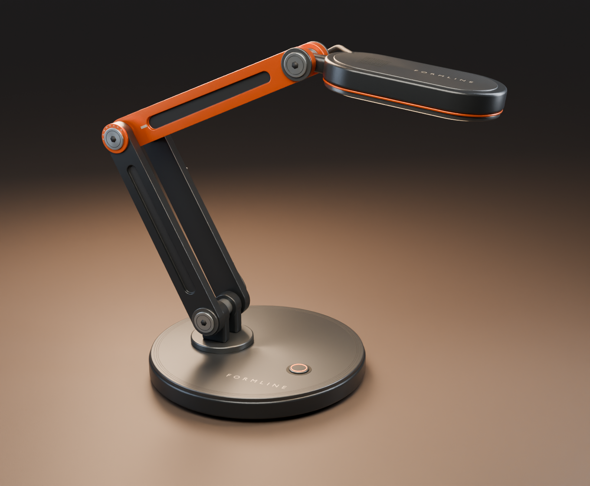
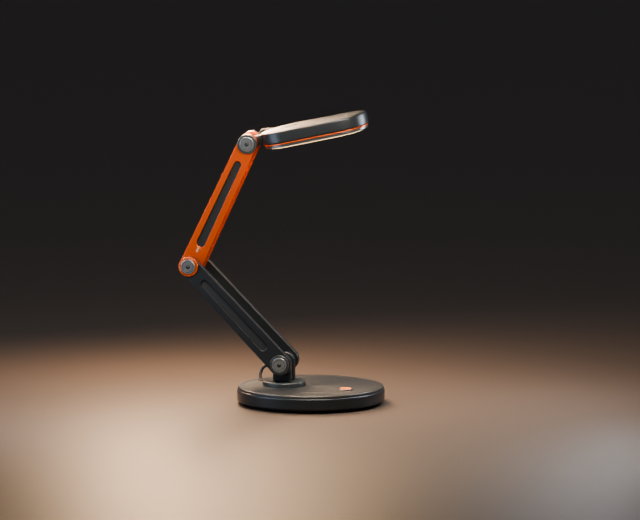
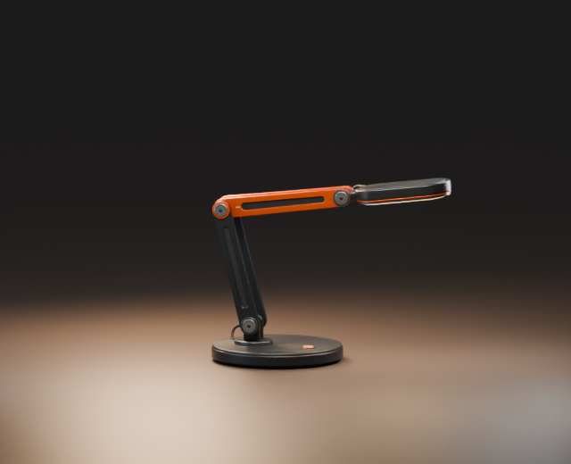
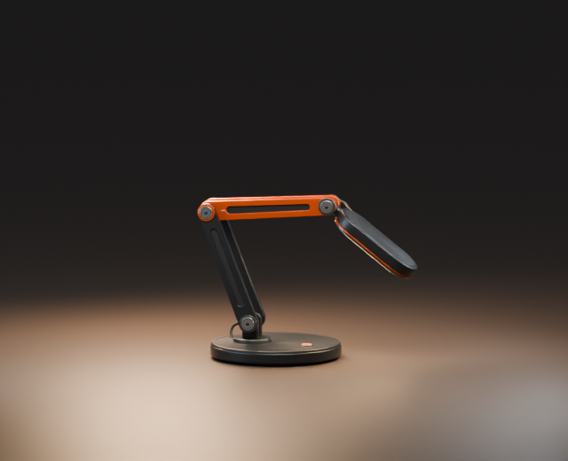

# Formline

Formline is a digital desk lamp concept in graphite, fired-orange aluminum, and warm opal light. Three driven hinges reposition the diffuser while the base stays fixed.



[Elbow detail](renders/detail.png) · [Product campaign](https://github.com/muhammmmadziam1234-eng/cirrus-formline-ad-campaigns#formline)

## Articulation study

| Raised | Forward | Lowered |
| :---: | :---: | :---: |
|  |  |  |

[Six-second stepped preview](renders/articulation-preview.mp4) · [Eight rendered poses](renders/motion) · [Editable Blender file](formline.blend)

Open **Articulation study** in Blender 4.5.4 and play frames **1–90** at **15 fps** for the continuous loop. The three named poses sit at frames **21**, **44**, and **64**. Frame 91 matches frame 1 and closes the action beyond the playback range.

To change the motion, select **FORMLINE — Motion controls**. Edit the angles under **Object Properties → Custom Properties** and key the changes at the current frame. The action exposes three named curves in the Graph Editor. For free posing, switch to **Studio stills** and select **FORMLINE — Pose controls**. Frame 1 selects the hero camera and frame 2 selects the elbow detail camera.

| Control | Default | Range | Reference |
| --- | ---: | ---: | --- |
| Shoulder tilt | −28° | −44° to −14° | Lower links from vertical |
| Elbow bend | 94° | 69° to 107° | Upper links relative to the lower links |
| Head pitch | −59° | −90° to −38° | Shade relative to the upper links |

## Measured reach and angles

Reach and height are measured at the center of the opal diffuser’s local bounding box. Reach is signed along +X from the base center, and height is measured from the studio floor. Positive shade pitch means nose-up from horizontal. **BU** means Blender units at the concept model’s scale.

| Pose | Frame | Shoulder / elbow / head | Forward reach (BU) | Height (BU) | Shade pitch |
| --- | ---: | ---: | ---: | ---: | ---: |
| Default | 1 | −28° / 94° / −59° | 1.31 | 2.54 | −7° |
| Raised | 21 | −44° / 69° / −38° | 0.08 | 3.44 | +13° |
| Forward | 44 | −14° / 97° / −90° | 1.87 | 2.40 | +7° |
| Lowered | 64 | −21° / 107° / −48° | 1.41 | 1.62 | −38° |

The evaluated **756-pose grid** spans all three joint limits in steps of at most 5°. Across those samples, reach spans **−0.33 to 1.88 BU**, height spans **1.32 to 4.11 BU**, and shade pitch spans **−55° to +65°**. The diffuser’s bounding box stays at least **0.80 BU** above the studio floor, rounded to two decimals. These are independent sampled ranges.

The build checks angle clamps, coaxial pins and fixed link lengths. Across all 91 action frames it also checks camera framing and proximity of the cable mesh to all 19 attachment anchors. [Numerical evidence](articulation-evidence.json)

## Assembly decisions

The wider lower links straddle the upper pair at the elbow. A stainless pin spans the stack, and thrust washers occupy the gaps between the moving links. Each link has a closed, machined recess modeled into its mesh. The circular base uses a separate elastomer foot, weighted housing and radially turned deck.

A single Bezier cable runs from the base gland to the shade. Its anchors follow the corresponding joint frames. Keepers support its straight runs, while the bend at each hinge sits outside the pin caps. The opal diffuser and a separate warm area emitter provide the visible luminous surface and task-light pool.

**Validation status.** The evidence covers digital geometry and kinematics. Part-to-part clearance, cable strain, joint friction, tipping, thermal behavior, and light output remain unverified. Physical prototyping and bench testing are pending.

## Rebuild

Use Blender 4.5.4 with its bundled Python. The source creates all geometry, text and materials procedurally.

```sh
blender --background --factory-startup --threads 3 --python-exit-code 1 --python build_formline.py
```

The script writes `formline.blend`, the numerical evidence, and the hero and detail renders. Add `-- --build-only` to skip rendering, `-- --view hero` or `-- --view detail` for one studio still, or `-- --motion` to render the eight 640 × 520 sequence plates and stepped MP4. The **Articulation study** scene is also configured to render the continuous loop from Blender’s **Render Animation** command.
